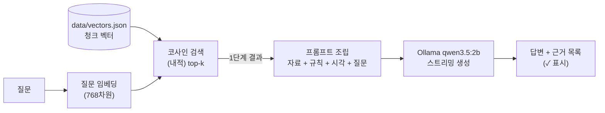

# warehouse-rag

물류창고 신규 작업자를 위한 재고 실사 안내 챗봇입니다. 질문하면 SOP와 위키백과 자료에서 근거를 찾아, 그 근거로만 답합니다. 내 PC에서만 실행하는 Node.js CLI입니다.

## 1. 소개

신규 작업자는 재고 실사 절차와 용어를 매번 선임에게 물어봐야 합니다. 이 챗봇이 그 질문을 대신 받습니다.

**답하는 것**
- 재고 실사 절차, 순환재고조사, 실사 차이 처리, 안전 수칙
- 재고·WMS·ABC 분석·FIFO·RFID/바코드 같은 용어

**답하지 않는 것**
- **실시간 재고 수량, 로케이션별 수량**: 자료에 없다고 말하고 **WMS에서 확인**하라고 안내하도록 설계했습니다. WMS 연동은 하지 않습니다.
- 자료에 없는 모든 질문: "제가 가진 자료에는 없습니다"라고 답하도록 했습니다.
- 웹 화면, 서버, 배포, 로그인도 만들지 않았습니다.

> `docs/sop.md`는 실제 회사 문서가 아니라 교육용으로 작성한 일반화된 예시입니다.

## 2. 동작 원리



1. **1단계 - 임베딩**: 청크 12개를 미리 벡터로 바꿔 `data/vectors.json`에 저장하고, 질문도 같은 모델로 벡터로 바꿉니다.
2. **1단계 - 검색**: 벡터가 정규화되어 있어 코사인 유사도는 내적과 같습니다. 점수 내림차순 top-k(기본 3)를 고르고, 1위가 `WEAK_THRESHOLD = 0.55`보다 낮으면 "관련 자료가 약함(⚠)"으로 표시합니다(결과는 버리지 않음).
3. **2단계 - 프롬프트 조립**: 자료 소개, 근거 원칙(1위 점수에 따라 2가지), 출처 규칙, KST 현재 시각, `[WH-xxx] (section) text` 형태의 자료, 질문, 출처 규칙 재강조 순으로 만듭니다.
4. **2단계 - 생성**: 시스템 메시지와 함께 Ollama `qwen3.5:2b`에 보내 `temperature: 0`으로 스트리밍 답변을 받습니다.
5. **근거 표시**: LLM에 맡기지 않고 코드가 합니다. 답변 뒤에 LLM에게 넘긴 자료를 모두 보여 주고, 답변에 ID가 적힌 자료에 ✓를 붙입니다.

## 3. 사용 기술

| 구분 | 내용 |
|---|---|
| 런타임 | Node.js (PowerShell에서 실행) |
| 임베딩 실행 | [transformers.js](https://github.com/huggingface/transformers.js) (`@huggingface/transformers`), `pipeline("feature-extraction", MODEL, { dtype: "q8" })` |
| 임베딩 모델 | `onnx-community/embeddinggemma-300m-ONNX` - q8, 768차원, 공식 프롬프트 형식 사용 |
| LLM | Ollama `qwen3.5:2b` (`http://localhost:11434`, `POST /api/chat`) |

embeddinggemma 입력 형식(공식 프롬프트 형식):
- 문서: `title: {section} | text: {text}`
- 질문: `task: search result | query: {question}`
- 호출 옵션: `{ pooling: "mean", normalize: true }`

임베딩 설정은 `src/embedder.mjs` 한 곳에서만 정의합니다. 벡터 저장소의 `model`·`dtype`이 현재 설정과 다르면 검색을 거부하고 build-index를 다시 실행하라고 안내합니다.

## 4. 실행 방법

**준비**

```powershell
ollama pull qwen3.5:2b
npm install
```

**1) 인덱스 만들기** (청크를 임베딩해 `data/vectors.json` 생성)

```powershell
node src/build-index.mjs
```

**2) 1단계: 검색만** (유사한 자료와 점수를 보여 줌)

```powershell
node src/search.mjs "재고 실사 차이가 나면 어떻게 처리해?"
```

**3) 2단계: 검색 + LLM 답변**

```powershell
node src/ask.mjs "A등급 품목은 얼마나 자주 세?"
```

`ask.mjs` 옵션

| 옵션 | 설명 |
|---|---|
| `--k N` | 검색해서 LLM에 넘길 자료 개수. 기본 3. 1 이상의 정수여야 합니다. |
| `--show-prompt` | LLM에 보낼 시스템 메시지와 프롬프트만 출력하고 끝냅니다. Ollama 없이도 동작합니다. |
| `--no-rag` | 검색 없이 질문만 LLM에 보냅니다. RAG 유무 비교용입니다. |

예: `node src/ask.mjs "내일 날씨 어때?" --k 5 --show-prompt`

Ollama 연결은 실제로 LLM을 호출할 때만 확인하며, 연결이 안 되면 확인 명령을 안내하고 종료합니다.

## 5. 자료

청크 원본은 `data/chunks.json`(`{ id, text, url, section }` 배열)입니다.

| id | section | 출처 |
|---|---|---|
| WH-001 | 재고의 정의 | https://ko.wikipedia.org/wiki/%EC%9E%AC%EA%B3%A0 |
| WH-002 | 재고자산의 정의 | https://ko.wikipedia.org/wiki/%EC%9E%AC%EA%B3%A0%EC%9E%90%EC%82%B0 |
| WH-003 | 재고의 범위 | https://ko.wikipedia.org/wiki/%EC%9E%AC%EA%B3%A0%EA%B4%80%EB%A6%AC |
| WH-004 | 재고관리의 목적 | https://ko.wikipedia.org/wiki/%EC%9E%AC%EA%B3%A0%EA%B4%80%EB%A6%AC |
| WH-005 | WMS 정의 | https://ko.wikipedia.org/wiki/%EC%B0%BD%EA%B3%A0%EA%B4%80%EB%A6%AC%EC%8B%9C%EC%8A%A4%ED%85%9C |
| WH-006 | 재고수량 결정 절차 | https://ko.wikipedia.org/wiki/%EC%9E%AC%EA%B3%A0%EA%B4%80%EB%A6%AC |
| WH-007 | ABC 분석 등급 | https://ko.wikipedia.org/wiki/ABC_%EB%B6%84%EC%84%9D |
| WH-008 | 선입선출법(FIFO) | https://ko.wikipedia.org/wiki/%EC%84%A0%EC%9E%85%EC%84%A0%EC%B6%9C%EB%B2%95 |
| WH-009 | RFID와 바코드 차이 | https://ko.wikipedia.org/wiki/RFID |
| WH-010 | 순환재고조사 | `docs/sop.md#순환재고조사` |
| WH-011 | 실사 차이 처리 | `docs/sop.md#실사-차이-처리` |
| WH-012 | 안전 수칙 | `docs/sop.md#안전-수칙` |

**청크 설계 원칙**
1. **사실 하나, 최소 120자**: 한 청크에는 사실 하나만 담고, 임베딩이 뜻을 잡을 만큼의 길이(최소 120자)를 둡니다.
2. **원문에 없는 말을 보태지 않음**: 출처에 있는 내용만 옮깁니다.
3. **확인 가능한 출처와 고정된 id**: 웹은 퍼센트 인코딩된 주소, SOP는 `docs/sop.md#제목`(공백은 하이픈)으로 적고, id는 WH-001부터 연속으로 붙이며 한 번 붙인 id의 뜻은 바꾸지 않습니다.

## 6. 1단계 관찰 기록

| # | 질문 | 1위 청크와 점수 | 비고 |
|---|---|---|---|
| 1 | 재고 실사 차이가 나면 어떻게 처리해? (정상) | WH-011 실사 차이 처리 0.761 | |
| 2 | 실사 수량이 장부랑 안 맞으면? (다른 표현) | WH-011 0.716 | "차이", "처리" 단어 없이도 같은 청크를 찾음 |
| 3 | ABC 분석이 뭐야? (정상) | WH-007 ABC 분석 등급 0.746 | |
| 4 | RFID랑 바코드 차이 (정상) | WH-009 0.816 | |
| 5 | 안전재고는 어떻게 계산해? (경계) | WH-001 재고의 정의 0.630 | 자료에 안전재고가 없는데 ⚠ 없이 엉뚱한 청크가 1위 |
| 6 | A등급 품목은 얼마나 자주 세? (경계) | WH-007 0.659, 2위 WH-010 0.658 | 사실상 동점. 실제 답(월 1회)은 2위 청크에 있음 |
| 7 | 우리 창고 지금 A-01 재고 몇 개야? (도메인 밖) | WH-001 0.541 | ⚠가 붙었지만 기준 0.55에 0.009 차이 |
| 8 | 내일 날씨 어때? (무관) | WH-010 0.429 | ⚠ |
| 9 | 김치찌개 레시피 알려줘 (무관) | WH-006 0.371 | ⚠ |

**생각해 볼 것**

1. **단어가 안 겹쳐도 찾는 이유** - 임베딩이 단어가 아니라 뜻을 비교하기 때문입니다(2번, 0.716).
2. **무관한 질문도 1위는 나온다** - 검색은 가장 가까운 것을 고를 뿐 답이 있는지는 모릅니다. 그래서 점수 기준(0.55)이 필요하고, 무관한 질문은 0.43 이하로 낮아 걸러집니다.
3. **점수만으로는 부족하다** - 5번(0.630)처럼 자료에 없어도 높은 점수가 나오고, 7번(0.541)은 기준에 아슬아슬합니다. 그래서 LLM에게 규칙(시스템 메시지)으로 "자료에 없으면 없다"고 알려 줘야 합니다.
4. **단어 하나에 끌려 엉뚱한 청크가 올라온다**(4번 2위 WH-012 안전 수칙 등) - 그래서 LLM에게 "근거에 있는 것만" 쓰라고 해야 합니다.

## 7. 2단계 비교 실험 기록

| 질문 | RAG 없이 | RAG | [WH-xxx] 표시 | 지어낸 내용? |
|---|---|---|---|---|
| A등급 품목은 얼마나 자주 세? | 세무 신고·세율 이야기로 흐름, 재고 조사와 무관 (14.3초) | "A 등급 품목은 월 1 회 조사합니다." (1.0초) | [WH-010], ✓ | 없이: 예 / RAG: 없음 |
| 우리 창고 지금 A-01 재고 몇 개야? | 숫자를 지어내지 않고 ERP·WMS 확인 안내 + 어떤 창고인지 되물음 (2.9초) | "제가 가진 자료에는 없습니다" (0.3초), WMS 안내는 빠짐 | 없음 (⚠) | 둘 다 없음 |
| 내일 날씨 어때? | 실시간 날씨를 제공하지 못한다며 검색 엔진·날씨 앱을 안내하고, 지역을 되묻는 어색한 문장으로 끝남 (2.1초) | ⚠, "제가 가진 자료에는 없습니다." (0.6초) | 없음 (⚠) | 없음 |

## 8. 한계와 다음 단계

**한계**
- **2B 모델의 한계**: 2단계 두 번째 질문에서 시스템 메시지가 요구한 "WMS에서 확인하라"는 안내가 빠졌습니다. 작은 모델은 규칙을 일부만 따를 수 있어, 프롬프트 규칙만으로 동작을 보장하기 어렵습니다. 비교한 질문이 3개뿐이라 일반화할 수는 없습니다.
- **검색만으로 "답이 없음"을 판단하기 어렵다**: 5번(0.630)은 자료에 없는데도 ⚠ 없이 엉뚱한 청크가 1위였고, 7번(0.541)은 기준 0.55에 0.009 차이였습니다. 6번처럼 1·2위가 사실상 동점이면 답이 2위에 있어도 1위 점수만으로는 알 수 없습니다. 점수 기준 하나로는 부족해서 LLM의 "자료에 없으면 없다" 규칙에 기대고 있습니다.
- 자료는 청크 12개이고, SOP는 교육용 예시입니다.

**다음에 해 볼 것**
- 질문 수를 늘려 점수 기준(0.55)이 적절한지 다시 확인하기
- 1·2위 점수 차가 작을 때를 따로 다루는 방법 시험하기
- "WMS 확인" 안내가 빠지는 문제를 프롬프트나 코드 쪽 처리로 보완하기
- `--no-rag` 비교를 1단계 관찰에 쓴 9개 질문으로 확대하기
